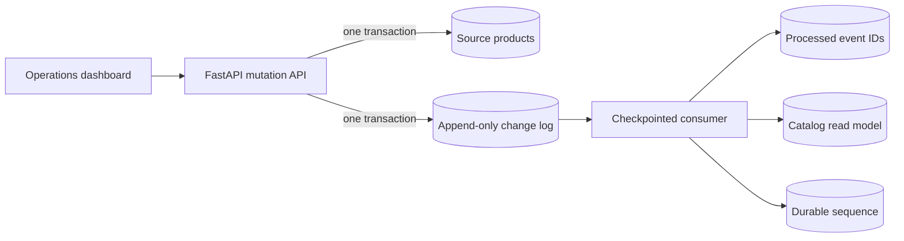

# PulseDB — Database Change Streaming Platform

PulseDB is a portfolio-ready Python project that demonstrates database change capture without hiding the reliability problems behind a framework. Product inserts, updates, and deletes are written to a source table and a transactional change log. A checkpointed consumer propagates those ordered events to a downstream catalog read model.

## What it demonstrates

- Transactional change capture: a source mutation and its event commit together.
- Ordered delivery using a monotonic database sequence.
- Durable consumer checkpoints that survive application restarts.
- Idempotent processing that detects duplicate event delivery.
- Pause, resume, restart, and full read-model rebuild demonstrations.
- Measured consumer lag, recent throughput, and p95 processing latency.
- A live operations dashboard, REST API, health check, tests, and Docker setup.

## Run in VS Code

Open this folder in VS Code, choose **Terminal → New Terminal**, then run:

```bash
python3 -m venv .venv
source .venv/bin/activate
pip install -r requirements.txt
uvicorn app:app --reload --port 8001
```

Open <http://127.0.0.1:8001>. API documentation is at <http://127.0.0.1:8001/docs>.

The repository also includes VS Code tasks for installing dependencies and running
tests, plus a **Run PulseDB** debug configuration. After installing dependencies,
open **Run and Debug** in VS Code and press the green play button.

For Docker:

```bash
docker compose up --build
```

## Recovery demonstration

1. Insert a few products and watch their events move to the read model.
2. Pause the consumer, then insert and update products. Consumer lag increases.
3. Resume the consumer. It continues from the stored sequence checkpoint.
4. Inject a duplicate. The duplicate count increases, while the read model remains unchanged.
5. Rebuild the read model. PulseDB clears the derived table and replays the complete event history.

## Architecture



The worker applies each event, stores its event ID, and advances its checkpoint in one transaction. If that transaction fails, its effects roll back and the same sequence is retried. A repeated event ID is acknowledged without being applied twice.

## Tests

```bash
python3 -m unittest discover -s tests -v
```

The tests cover ordered insert/update/delete propagation, duplicate delivery, pause/resume checkpoint recovery, and a full snapshot rebuild.

## Production evolution

This local demo uses SQLite and an in-process worker so recruiters can run it with one command. At production scale, PostgreSQL logical replication or Debezium would publish the source log to Kafka; consumers would use partition keys, consumer groups, schema versioning, dead-letter handling, metrics, tracing, and retention policies. A production service also needs authentication and authorization before exposing mutation or recovery controls.
