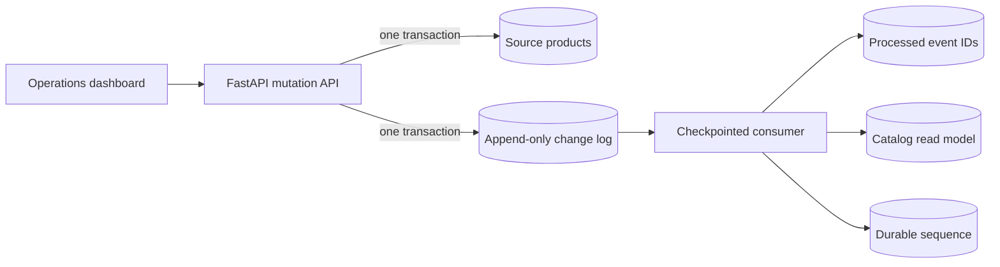

# PulseDB — Database Change Streaming Platform


> Capture mutations. Preserve order. Recover every consumer.

PulseDB is a portfolio-ready Python project that demonstrates database change capture without hiding the reliability problems behind a framework. Product inserts, updates, and deletes are written to a source table and a transactional change log. A checkpointed consumer propagates those ordered events to a downstream catalog read model.

The project includes a dark operations control plane where an engineer can create
source changes, inspect the ordered event stream, watch consumer lag, pause and
resume processing, inject duplicate deliveries, and rebuild the read model.

## What it demonstrates

- Transactional change capture: a source mutation and its event commit together.
- Ordered delivery using a monotonic database sequence.
- Durable consumer checkpoints that survive application restarts.
- Idempotent processing that detects duplicate event delivery.
- Pause, resume, restart, and full read-model rebuild demonstrations.
- Measured consumer lag, recent throughput, and p95 processing latency.
- A live operations dashboard, REST API, health check, tests, and Docker setup.

## Reliability model

| Problem | PulseDB approach |
| --- | --- |
| A source update succeeds but its event is lost | Source row and change event commit in one database transaction |
| Events arrive out of order | A monotonically increasing sequence determines processing order |
| A consumer restarts | The consumer resumes after its persisted sequence checkpoint |
| The broker delivers an event twice | A unique processed-event ID makes the consumer idempotent |
| The derived view becomes corrupted | The read model can be cleared and rebuilt from event history |
| Operators cannot see stream health | Dashboard reports lag, throughput, p95 latency, and activity |

## Run in VS Code

Open this folder in VS Code, choose **Terminal → New Terminal**, then run:

```bash
python3 -m venv .venv
source .venv/bin/activate
pip install -r requirements.txt
uvicorn app:app --reload --port 8001
```

Open <http://127.0.0.1:8001>. API documentation is at <http://127.0.0.1:8001/docs>.

The repository also includes VS Code tasks for installing dependencies and running
tests, plus a **Run PulseDB** debug configuration. After installing dependencies,
open **Run and Debug** in VS Code and press the green play button.

For Docker:

```bash
docker compose up --build
```

## Recovery demonstration

1. Insert a few products and watch their events move to the read model.
2. Pause the consumer, then insert and update products. Consumer lag increases.
3. Resume the consumer. It continues from the stored sequence checkpoint.
4. Inject a duplicate. The duplicate count increases, while the read model remains unchanged.
5. Rebuild the read model. PulseDB clears the derived table and replays the complete event history.

## API reference

| Method | Endpoint | Purpose |
| --- | --- | --- |
| `POST` | `/api/products` | Insert a source product and emit an `INSERT` event |
| `PATCH` | `/api/products/{id}` | Update a source product and emit an `UPDATE` event |
| `DELETE` | `/api/products/{id}` | Delete a source product and emit a `DELETE` event |
| `GET` | `/api/state` | Return stream, checkpoint, read-model, and metrics state |
| `POST` | `/api/consumer/pause` | Pause event consumption so lag can accumulate |
| `POST` | `/api/consumer/resume` | Continue from the durable checkpoint |
| `POST` | `/api/consumer/restart` | Simulate recovery after a consumer restart |
| `POST` | `/api/consumer/duplicate` | Inject a repeated event ID to test idempotency |
| `POST` | `/api/consumer/rebuild` | Clear and replay the downstream read model |
| `GET` | `/health` | Report API and consumer health |

## Architecture



The worker applies each event, stores its event ID, and advances its checkpoint in one transaction. If that transaction fails, its effects roll back and the same sequence is retried. A repeated event ID is acknowledged without being applied twice.

## Tests

```bash
python3 -m unittest discover -s tests -v
```

The tests cover ordered insert/update/delete propagation, duplicate delivery, pause/resume checkpoint recovery, and a full snapshot rebuild.

## Project structure

```text
.
├── app.py                  # API, change log, consumer, checkpoint and read model
├── static/index.html       # Responsive operations control plane
├── tests/test_streaming.py # Reliability-focused automated tests
├── Dockerfile              # Non-root production-style container
├── compose.yaml            # Persistent local Docker environment
├── requirements.txt
└── .vscode/                # Run/debug and test tasks for VS Code
```

## Engineering decisions

- **Transactional outbox instead of dual writes:** source changes and events cannot
  diverge after a partial failure.
- **At-least-once delivery with idempotency:** the project avoids an unrealistic
  exactly-once claim and safely handles repeated delivery.
- **Derived read model:** query-facing data is disposable and reproducible from the
  event history.
- **Measured values only:** latency, throughput, and lag come from processed events;
  the README does not claim benchmark numbers that were never measured.

## Production evolution

This local demo uses SQLite and an in-process worker so recruiters can run it with one command. At production scale, PostgreSQL logical replication or Debezium would publish the source log to Kafka; consumers would use partition keys, consumer groups, schema versioning, dead-letter handling, metrics, tracing, and retention policies. A production service also needs authentication and authorization before exposing mutation or recovery controls.

## Interview talking points

- Why a transactional outbox prevents missing events.
- Why at-least-once delivery requires idempotent consumers.
- How a checkpoint allows recovery without replaying the entire stream.
- When Kafka partitions preserve order and when they do not.
- How snapshot rebuilds support schema changes and disaster recovery.

## Author

Built by [Rachit Tripathi](https://github.com/rachit1807) as a backend and
distributed-systems portfolio project.
